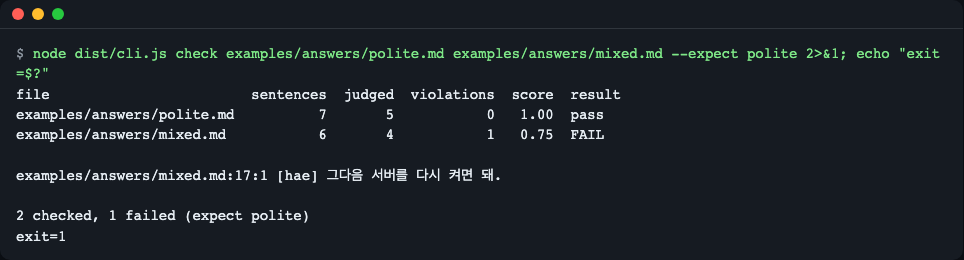
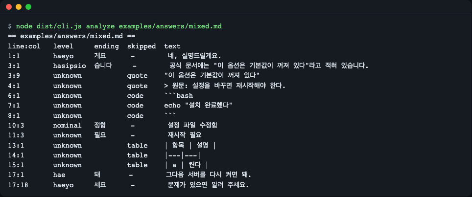
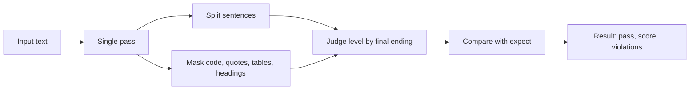
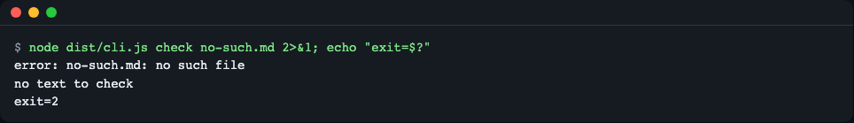
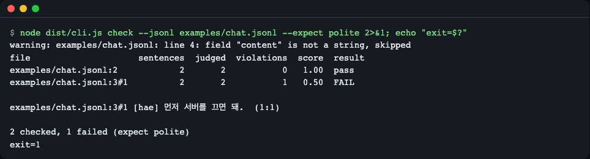
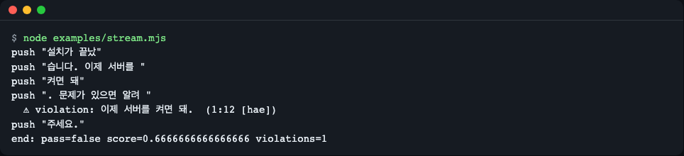
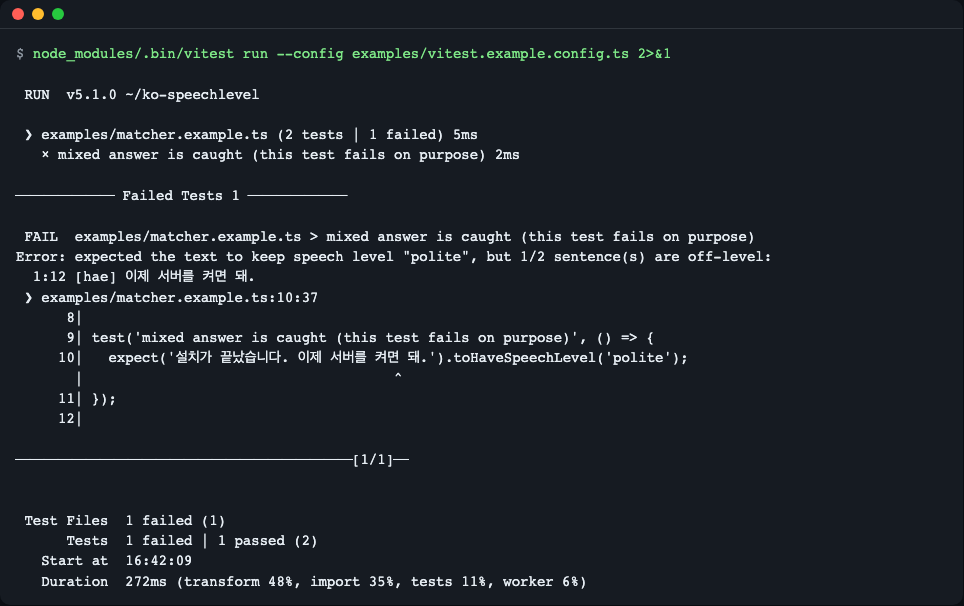

# ko-speechlevel

[한국어](README.md) | **English**

A deterministic checker that finds Korean sentences whose speech level (honorific style) slips partway through a text. An LLM answer may start with "했습니다" (polite) and end with "켜면 돼." (casual); this tool catches that using rules alone and reports exact offsets. It makes no model calls, so the same input always gives the same result, which suits evaluation pipelines and CI assertions. It has no runtime dependencies and ships as a library, a CLI, a streaming checker, a promptfoo assertion and a vitest matcher. Install from GitHub: `npm install github:LeeGyeongPil/ko-speechlevel#v0.1.2` (the npm registry release is planned, not published yet). The GitHub install builds via a `prepare` script, which npm's install-script settings (e.g. `ignore-scripts`) may block.



*Figure 1. Checking two files flags one casual-style (해체) sentence on line 17 of `mixed.md` as a violation, and the command exits with code 1. The command in the figure is `node dist/cli.js check examples/answers/polite.md examples/answers/mixed.md --expect polite`. `npm start` in the install section checks three files, up to `quoted-source.md`, with `--exit-zero`, so it shows the same single violation but exits with code 0.*

## Install

For now, install from GitHub. Publishing to the npm registry is **planned** and has not happened yet.

```bash
# Add to your project (it builds automatically during install)
npm install github:LeeGyeongPil/ko-speechlevel#v0.1.2

# Or clone and run it directly
git clone https://github.com/LeeGyeongPil/ko-speechlevel.git
cd ko-speechlevel
npm install
npm start
```

```text
# Planned (does not work yet)
npm install ko-speechlevel
```

The GitHub install builds with the `prepare` script. If npm's install-script settings (such as `ignore-scripts`) block this build, `dist` is missing and imports fail. Check your settings, or clone the repo and build it with `npm install`.

Node.js 22 or later is required (get Node from <https://nodejs.org/>). There are 0 runtime dependencies. Only the vitest matcher needs vitest 5 or later, and it is optional.

## Why it is needed

Even if the system prompt says "answer politely", the speech level can drift inside a single answer. There are two common causes.

- **The user asked in casual speech.** The answer follows the tone of the question, and a few sentences end in casual speech.
- **The source document uses the plain-declarative style (해라체, `-다`).** When summarizing a regulation or a wiki page, the source's `-한다` leaks into the summary.

Below is a hand-written sample (not real model output). The second sentence keeps the source's speech level. (Gloss: "I checked the rules. Refunds must be requested within 7 days. We will let you know the result by text message.")

```text
규정을 확인했습니다. 환불은 7일 이내에 신청한다. 처리 결과는 문자로 안내드립니다.
```

A person has to scan the text to find this kind of slip. Asking a model "is this polite?" costs a model call, and the answer may differ from run to run. This tool checks the same sample with rules only and reports the offending sentence and its position.

```bash
echo '규정을 확인했습니다. 환불은 7일 이내에 신청한다. 처리 결과는 문자로 안내드립니다.' | node dist/cli.js check - --expect polite
```

```text
file     sentences  judged  violations  score  result
<stdin>          3       3           1   0.67  FAIL

<stdin>:1:13 [haera] 환불은 7일 이내에 신청한다.

1 checked, 1 failed (expect polite)
```

## Quick start

`examples/quickstart.mjs`:

```js
import { check } from 'ko-speechlevel';

const answer = '설치가 끝났습니다. 이제 서버를 켜면 돼. 문제가 있으면 알려 주세요.';
const r = check(answer, 'polite');
console.log(`pass=${r.pass} score=${r.score.toFixed(2)} judged=${r.judged}`);
for (const v of r.violations) console.log(`${v.line}:${v.column} [${v.level}] ${v.text}`);
```

```bash
node examples/quickstart.mjs
```

```text
pass=false score=0.67 judged=3
1:12 [hae] 이제 서버를 켜면 돼.
```

(Gloss of the input: "Installation is done. Now just turn on the server. Let me know if there is a problem.")

Two of the three sentences are polite (`합쇼체`, `해요체`) and one is casual (`해체`), so the score is 2/3. The violating sentence starts at line 1, column 12 of the input.

## Core concepts

1. **Only the final ending of a sentence is checked.** The text is split into sentences, and the speech level is decided from the last character of the last Hangul word. Honorific forms such as `께서` or `-시-` are not examined (so "선생님께서 오셨다." is `haera`).
2. **Four speech levels are judged.**

   | Level | Name | Example endings |
   |---|---|---|
   | `hasipsio` | 합쇼체 (formal polite) | 습니다, -ㅂ니다 |
   | `haeyo` | 해요체 (informal polite) | 게요, 세요 |
   | `hae` | 해체 (casual) | 돼 |
   | `haera` | 해라체 (plain declarative) | 한다 |

   Use `--expect` (`expect` in the library) to choose the level to enforce: `polite` (합쇼체 + 해요체, the default), `hasipsio`, `haeyo`, or `casual` (해체 + 해라체).
3. **What is not judged is not a violation.** The masked regions in the table below, sentences that cannot be judged (`unknown`) and noun-ending sentences (`nominal`) do not count toward the score.
4. **Score** = (judged sentences - violations) / judged sentences. If there are no judged sentences, the score is 1. By default any violation fails the check, and `minScore` can lower the bar.

### Exceptions to the judging rules

| Target | Default behavior | How to turn it on | Example |
|---|---|---|---|
| Code: fences (```` ``` ````, `~~~`, including unclosed ones), inline code, and code indented by 4 spaces or a tab at the first line of the document or after a blank line (not inside lists) | Not judged (`code`) | Cannot be turned on | `echo "설치 완료했다"` |
| HTML comments `<!-- -->` (multi-line if opened at the start of a line; if opened mid-line, only when closed on the same line) | Not judged (`comment`) | Cannot be turned on | `<!-- 끝났다. -->` |
| Emphasis `**bold.**` `*italic.*` `_underline._` `~~strikethrough.~~` | **Judged** (the markup is stripped before reading the ending; positions refer to the original text) | - | `**이제 끝났어.**` → `hae` |
| Text in quotation marks, `>` quote blocks | Not judged (`quote`) | `--include quotes` / `include.quotes` | `"이 옵션은 … 꺼져 있다"` |
| Tables (lines starting with `\|`) | Not judged (`table`) | `--include tables` / `include.tables` | `\| a \| 켠다 \|` |
| Headings (`#`) | Not judged (`heading`) | `--include headings` / `include.headings` | `## 요약` |
| List items | **Judged** | Turn off: `--skip-lists` / `include.lists: false` | `- 설정 파일 수정함` |
| Noun-form endings (-함, -됨, etc.) | Not a judging target (`nominal`) | - | `설정 파일 수정함` |
| Sentences ending in a noun, and nouns that look like endings such as `개발자` or `한국어` | Cannot be judged (`unknown`) | - | `재시작 필요` |
| Input size limit | Library `maxLength` defaults to 2,000,000 UTF-16 units; CLI `--max-bytes` defaults to 5,242,880 bytes | Adjustable with options | An error if exceeded |



*Figure 2. `analyze` shows the verdict and the reason for skipping (`code`, `quote`, `table`) for each sentence. Quotes, code and tables stay `unknown`, and `설정 파일 수정함` is `nominal`.*

### How it works



A single-pass scanner handles masking, sentence splitting and ending judgment together. The judgment uses only "the characters seen so far plus the next one character", so the result is the same however the text is cut into chunks. That is why whole-text checking (`check`) and streaming checking (`createStreamChecker`) share the same code. Masked characters still stay inside the sentence offsets, so `text.slice(start, end)` is always equal to `sentence.text`. There is no regex backtracking, so running time grows linearly even on long inputs.

## CLI

```bash
ko-speechlevel <check|analyze> <files...|-> [options]
```

In a clone, run the same command as `node dist/cli.js` (all examples below use this form).

| Option | Meaning |
|---|---|
| `--expect <polite\|hasipsio\|haeyo\|casual>` | Speech level to enforce (default polite) |
| `--format <table\|json>` | Output format (default table) |
| `--include <tables,headings,quotes>` | Also judge regions that are skipped by default |
| `--skip-lists` | Do not judge list items |
| `--min-score <0..1>` | Minimum passing score (default 1) |
| `--jsonl` / `--field <path>` / `--role <name>` | Check JSON Lines chat logs (default field `content`, role `assistant`) |
| `--max-bytes <n>` | Maximum accepted input size (default 5242880) |
| `--exit-zero` | Exit with code 0 even when there are violations (input errors still give 2) |
| `-` | Used in place of a file name, reads standard input |

### Exit codes

| Code | Meaning |
|---|---|
| 0 | All passed (with `--exit-zero`, 0 even when there are violations) |
| 1 | Violations found |
| 2 | Input or usage error. Each error prints one `error: …` line (no stack trace); if there is nothing to check, `no text to check` is printed at the end. If only some of several files fail, the rest are still checked and the final code is 2. An invalid option value also gives 2 and says how to fix it |

```bash
node dist/cli.js check examples/answers/mixed.md --max-bytes -1
```

```text
error: --max-bytes needs a positive integer, e.g. --max-bytes 1048576; a value that starts with "-" must be written as --max-bytes=<value>
```



*Figure 3. An input error ends with exit code 2, which is distinct from a violation (1). The `no text to check` line under the `error:` line means there was no text to check.*

### Chat logs (JSON Lines)

`examples/chat.jsonl` has one message per line, or lines that contain a `messages` array. By default only the `content` of the `assistant` role is checked.

```bash
node dist/cli.js check --jsonl examples/chat.jsonl --expect polite
```



*Figure 4. `3#1` is `messages[1]` on line 3. The parentheses at the end give the line:column inside the content. Line 4 is skipped with a warning because its `content` is not a string.*

## API

```ts
import { check, analyze, classifyEnding, createStreamChecker, SpeechLevelInputError } from 'ko-speechlevel';
```

| Name | What it does | Main arguments | Returns |
|---|---|---|---|
| `check(text, expectOrOptions?)` | Finds violating sentences and computes pass/fail and the score | The second argument is a string such as `'polite'`, or `{ expect, minScore, include, maxLength }` | `CheckResult` = `{ expect, pass, score, judged, counts, violations }` |
| `analyze(text, options?)` | Returns every sentence and skipped region in order | `{ include, maxLength }` | `SentenceResult[]` (`text, start, end, line, column, level, ending, skipped?`) |
| `classifyEnding(sentence)` | Judges the ending of a single sentence only | A sentence string | `EndingResult` (`level`, `ending`) |
| `createStreamChecker(options?)` | Takes chunks and notifies the moment a sentence is finalized | `{ expect, onViolation, onSentence, ... }` | `StreamChecker` (`push(chunk)` → array of newly finalized sentences, `end()` → the same result as `check`) |
| `SpeechLevelInputError` | Exception for invalid input or options | `code` | `ERR_INPUT_TYPE`, `ERR_INPUT_TOO_LARGE`, `ERR_OPTION`, `ERR_STATE` (`push` after `end()`) |
| `ko-speechlevel/promptfoo` | promptfoo assertion function | `config: { expect }` | `{ pass, score, reason }` (an invalid config gives `pass: false` without throwing) |
| `ko-speechlevel/vitest` | Registers the `toHaveSpeechLevel(level, options?)` matcher | Registered just by importing it | On failure, a message listing the violating sentences |

The value constants `LEVELS`, `EXPECTS`, `DEFAULT_MAX_LENGTH` and the types `Level`, `Expect`, `Include`, `SkipKind`, `CheckOptions`, `AnalyzeOptions`, `CheckResult`, `SentenceResult` are also exported. The column is counted in UTF-16 units.

Invalid input is reported as an exception (`examples/errors.mjs`).

```text
ERR_INPUT_TYPE: Expected the text to be a string but got number. Convert it with String(value) first.
ERR_INPUT_TOO_LARGE: Input has 5 characters, over the maxLength of 2. Split the text or raise maxLength.
ERR_OPTION: Unknown expect "formal". Use one of: polite, hasipsio, haeyo, casual.
```

## Usage examples

### 1. Warn right away while receiving a streaming response

```bash
node examples/stream.mjs
```



*Figure 5. A violating sentence is reported at the moment the next character arrives and the sentence is finalized. The chunks are fixed strings written by hand, not real model output.*

### 2. Assert in a vitest test

```ts
import 'ko-speechlevel/vitest';
import { expect, test } from 'vitest';

// This test fails on purpose: it contains a casual-style sentence.
test('mixed answer is caught', () => {
  expect('설치가 끝났습니다. 이제 서버를 켜면 돼.').toHaveSpeechLevel('polite');
});
```

```bash
npx vitest run --config examples/vitest.example.config.ts
```



*Figure 6. The command on screen is `node_modules/.bin/vitest run …`, which is the same run as the `npx vitest run …` in the text. This example deliberately includes a failing case (the second test in `examples/matcher.example.ts`). The matcher message lists the violating sentences.*

### 3. A promptfoo evaluation assertion

In your own project, run `npm install promptfoo`, create a bridge with a one-line `speechlevel.mjs`, and point to it from the test case as a file.

```js
export { default } from 'ko-speechlevel/promptfoo';
```

The example in this repo (`examples/promptfoo/speechlevel.mjs`) imports the built `dist` by relative path so it runs without installing the package. `npm run example:promptfoo` below downloads and runs a pinned version with `npx --yes promptfoo@0.125.1`, so the first run needs network access and takes about a minute. This repo does not keep a promptfoo dependency tree (`package.json` and lock file). Security advisories for promptfoo and its dependencies are the responsibility of promptfoo upstream and are unrelated to this library's runtime (zero dependencies). The example is optional and is not needed to use the library.

```yaml
assert:
  - type: javascript
    value: file://speechlevel.mjs
    config:
      expect: polite
```

```bash
npm run example:promptfoo
```

The run ends with these two lines (the download log of the first run is omitted).

```text
failed case: 1/2 off-level: @11 [hae] 이제 서버를 켜면 돼.
promptfoo: 1 passed, 1 failed (as expected)
```

*The example uses the `echo` provider, which returns the prompt as is. It checks two hand-written answers, with no LLM call and no API key. One case is made to fail on purpose, so "1 failed (as expected)" is normal. On a restricted network you may see a log saying the connection to promptfoo's telemetry was refused, but it does not affect the evaluation.*

### 4. Use it in CI

```bash
node dist/cli.js check examples/answers/polite.md --expect polite   # exit code 1 fails the pipeline if there are violations
```

## When to use it

- Use it when: you regression-test LLM output that must stay polite, such as customer support or document summaries, or compare the speech-level consistency of several models and prompts as a number. Also when you need the position (offset) of each violation.
- Scope of this tool: it is a rule-based check that judges by the sentence-final ending. It does not look at whether a sentence is natural, whether honorific expressions are grammatically correct, or whether the content is right.
- Use another tool when: you want a model to grade quality other than speech level. Use the model-based assertions of the evaluation framework [promptfoo](https://www.promptfoo.dev/docs/) and similar. This library can be used inside it as a rule-based assertion.

## Comparison with existing tools

There are tools that solve a similar problem, but they work differently. The table below is a shortened version of the descriptions checked at the time of research (2026-11-11). Each tool keeps changing, so check the links for the latest information.

| Target | What it is | How it differs from this tool |
|---|---|---|
| Polite/casual classification model ([korean-formal-classifier](https://github.com/jongmin-oh/korean-formal-classifier), [model card](https://huggingface.co/j5ng/kcbert-formal-classifier)) | Python, a fine-tuned KcBERT binary classifier | Its purpose is to tell polite from casual per sentence, and it needs a model download and `transformers`. I could not confirm a feature that reports sentence positions. This tool uses rules, with no model, to give four levels and offsets |
| Morphological analyzer ([Kiwi WASM `kiwi-nlp`](https://github.com/bab2min/Kiwi/tree/main/bindings/wasm)) | Korean morphological analysis | It can give final-ending tags, but speech-level judgment, masking of code and quotes, and assertions would have to be built by hand. Because it loads a separate model file, I judged it too heavy for a CI assertion. It is useful as a baseline for comparing accuracy |
| LLM judge (promptfoo [`llm-rubric`](https://www.promptfoo.dev/docs/configuration/expected-outputs/) and similar) | A model grades "is this polite?" | It can also judge quality beyond speech level. However, it costs model calls, results may differ from run to run, and it gives no violation positions. This tool is deterministic, free, and also works during streaming |

The two approaches are not replacements for each other. Items that rules can sort out, such as speech level, can be blocked quickly with this tool, and the remaining quality can be left to a model judge. For reference, Japanese has a textlint rule for the same problem ([textlint-rule-no-mix-dearu-desumasu](https://github.com/textlint-ja/textlint-rule-no-mix-dearu-desumasu)); its design of setting the style separately for body text, lists and headings was a reference here.

## Known limitations

- If one sentence is split across lines (a hard-wrapped paragraph), each line fragment is judged separately, and a fragment whose ending cannot be determined is `unknown`.
- Unpaired quotation marks or backticks mask text to the end of that line (it errs on the side of missing things).
- The boundary between 해체 and 해라체 (`-지`, `-네`, `-니`) is approximate. 하오체 and 하게체 are `unknown`. 해라체 is not yet an `--expect` target and is included in `casual`.
- Cases where a sentence-final noun looks like an ending (개발자, 한국어, 분야, etc.) are handled only by an exception word list.
- Indirect quotation is not handled. Only text in quotation marks and `>` quote blocks are skipped.
- Only lines that start with `|` are treated as tables.
- Indented code is recognized only at the first line of the document or after a blank line, and outside lists. Text indented by 4 spaces near a list is judged.
- In the rare input where `<` is repeated mid-line and then `<!--` follows (`a <<!-- …`), everything after it to the end of the document is treated as an HTML comment and masked (it errs on the side of missing things).
- A sentence that ends with a parenthesis (`끝났어(진짜로).`) reads its ending from the word inside the parentheses and becomes `unknown`.

### Reporting false positives and false negatives

If a judgment is wrong, please leave these three things in an issue.

1. The wrong sentence, on one line
2. The level you expected (`hasipsio`, `haeyo`, `hae`, `haera`, `nominal`, `unknown`)
3. The output of `node dist/cli.js analyze <file>`

Confirmed cases are added as one row to the regression table `test/regression-table.ts` so they do not go wrong again.

## Troubleshooting

| Symptom | Cause | Fix |
|---|---|---|
| The exit code is 1 but I want CI to pass | Finding a violation gives 1 | Only report with `--exit-zero`, or lower the bar with `--min-score` |
| Exit code 2 with `error: …` | A missing file, too large an input, an invalid `--expect`, a broken JSON line, etc. | Fix it as the message says. Input errors do not become 0 even with `--exit-zero` |
| Casual speech inside a quotation is not caught | Quotation marks and `>` quotes are excluded by default | `--include quotes` |
| `Cannot find module 'ko-speechlevel'` (running an example in a clone) | Not built yet | Run `npm install` (or `npm run build`) first |
| It cannot be installed from npm | It is not published to the registry yet | `npm install github:LeeGyeongPil/ko-speechlevel#v0.1.2` |

## Versions and compatibility

- It follows Semantic Versioning (SemVer). While at 0.x, the API may change in a minor version, and changes are recorded in [CHANGELOG.md](CHANGELOG.md).
- Node.js 22 or later; the vitest matcher needs vitest 5 or later.

## Development and contributing

```bash
npm install
npm test            # build, then run vitest: 8 files, 218 tests
npm run check:pack  # check package contents and exports
npm run check:release  # check version, CHANGELOG and tag consistency
```

For how to report a bug, see "Reporting false positives and false negatives" above. For security issues, see [SECURITY.md](SECURITY.md).

## Further reading

- Korean honorifics and speech-level classification: the National Institute of Korean Language's Standard Korean Dictionary <https://stdict.korean.go.kr/> (checked 2026-11-11)
- promptfoo assertion docs: <https://www.promptfoo.dev/docs/configuration/expected-outputs/> (checked 2026-11-11)
- Extending vitest matchers: <https://vitest.dev/guide/extending-matchers> (checked 2026-11-11)

## License

MIT.
