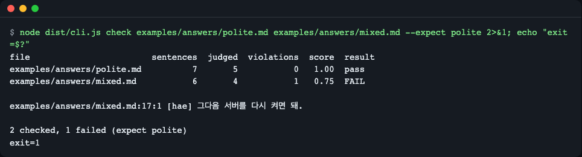
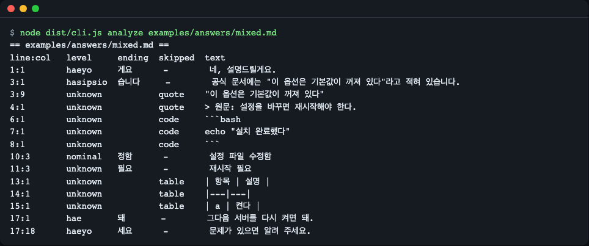
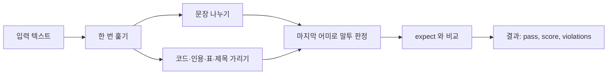
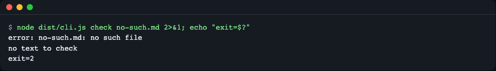
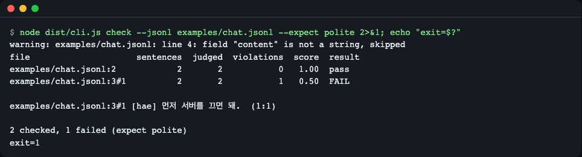
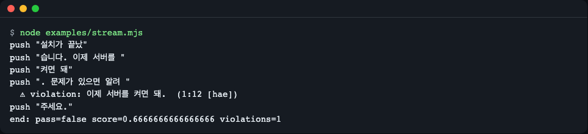
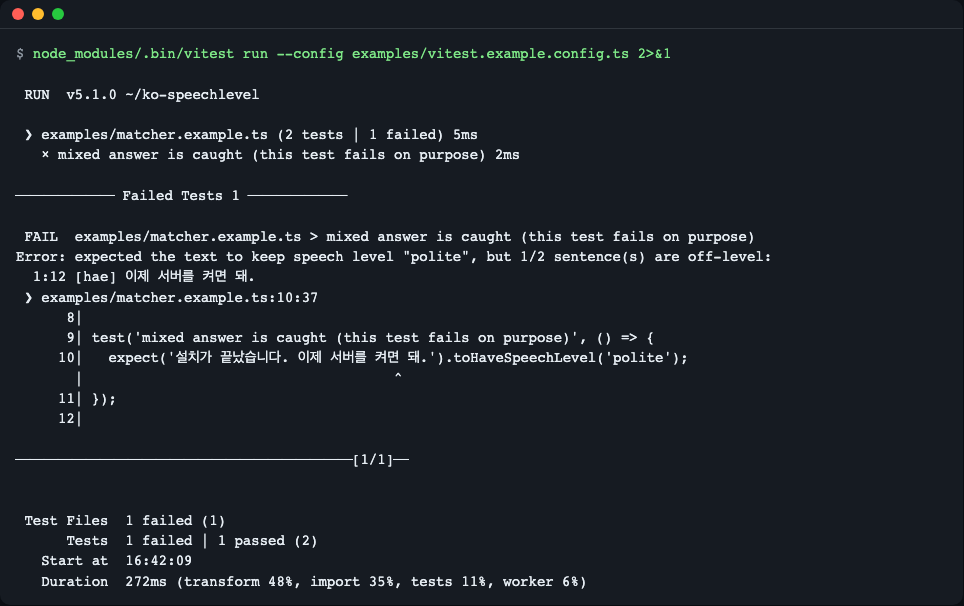

# ko-speechlevel

> **English summary** — A deterministic checker that flags Korean sentences whose speech level (honorific style) slips, for example from polite `-습니다/-요` to casual `-해/-다`, and reports exact offsets. It has no runtime dependencies and ships as a library, a CLI, a streaming checker, a promptfoo assertion and a vitest matcher. Install from GitHub: `npm install github:LeeGyeongPil/ko-speechlevel#v0.1.2` (the npm registry release is planned, not published yet). The GitHub install builds via a `prepare` script, which npm's install-script settings (e.g. `ignore-scripts`) may block.

LLM 답변이 "했습니다"로 시작해 "켜면 돼."로 끝나는 식으로 **말투가 중간에 바뀌는 문제**를 규칙만으로 찾아 주는 검사기입니다. 다른 모델 호출 없이 같은 입력에는 항상 같은 결과가 나오므로, 평가 파이프라인과 CI의 단언(assertion)으로 쓰기 좋습니다.



*그림 1. 두 파일을 검사하면 `mixed.md` 17행의 해체 문장 하나가 위반으로 잡히고 종료 코드 1로 끝납니다. 그림의 명령은 `node dist/cli.js check examples/answers/polite.md examples/answers/mixed.md --expect polite` 입니다. 설치 절의 `npm start` 는 `quoted-source.md` 까지 세 파일을 `--exit-zero` 로 검사하므로 같은 위반 1건이 보이지만 종료 코드는 0입니다.*

## 설치

현재는 GitHub에서 설치합니다. npm 레지스트리 게시는 **예정**이며 아직 되어 있지 않습니다.

```bash
# 프로젝트에 추가 (설치 중 자동으로 빌드됩니다)
npm install github:LeeGyeongPil/ko-speechlevel#v0.1.2

# 또는 clone 해서 직접 실행
git clone https://github.com/LeeGyeongPil/ko-speechlevel.git
cd ko-speechlevel
npm install
npm start
```

```text
# 게시 예정 (아직 동작하지 않음)
npm install ko-speechlevel
```

GitHub 설치는 `prepare` 스크립트로 빌드합니다. npm 의 install script 허용 설정(`ignore-scripts` 등)에 따라 이 빌드가 막히면 `dist` 가 없어 import 가 실패하므로, 설정을 확인하거나 clone 후 `npm install` 로 직접 빌드하세요.

Node.js 22 이상이 필요합니다(Node 설치: <https://nodejs.org/>). 런타임 의존성은 0개입니다. vitest 매처만 선택 사항으로 vitest 5 이상이 필요합니다.

## 왜 필요한가

시스템 프롬프트에 "존댓말로 답하세요"를 넣어도, 답변 한 편 안에서 말투가 섞이는 일이 생깁니다. 흔한 원인은 두 가지입니다.

- **사용자가 반말로 물어본 경우** — 질문의 말투를 따라가다 문장 몇 개가 반말로 끝납니다.
- **근거 문서가 해라체(`-다`)인 경우** — 규정·위키 같은 원문을 요약하다 원문의 `-한다` 가 그대로 새어 나옵니다.

아래는 직접 쓴 표본입니다(실제 모델 출력이 아닙니다). 두 번째 문장에 원문의 말투가 남았습니다.

```text
규정을 확인했습니다. 환불은 7일 이내에 신청한다. 처리 결과는 문자로 안내드립니다.
```

이런 문제는 사람이 눈으로 훑어야 찾을 수 있고, 모델에게 "존댓말인지 봐 줘"라고 시키면 호출 비용이 들고 결과가 매번 다를 수 있습니다. 이 도구는 같은 표본을 규칙만으로 검사해 위반 문장과 위치를 알려 줍니다.

```bash
echo '규정을 확인했습니다. 환불은 7일 이내에 신청한다. 처리 결과는 문자로 안내드립니다.' | node dist/cli.js check - --expect polite
```

```text
file     sentences  judged  violations  score  result
<stdin>          3       3           1   0.67  FAIL

<stdin>:1:13 [haera] 환불은 7일 이내에 신청한다.

1 checked, 1 failed (expect polite)
```

## 빠르게 시작하기

`examples/quickstart.mjs`:

```js
import { check } from 'ko-speechlevel';

const answer = '설치가 끝났습니다. 이제 서버를 켜면 돼. 문제가 있으면 알려 주세요.';
const r = check(answer, 'polite');
console.log(`pass=${r.pass} score=${r.score.toFixed(2)} judged=${r.judged}`);
for (const v of r.violations) console.log(`${v.line}:${v.column} [${v.level}] ${v.text}`);
```

```bash
node examples/quickstart.mjs
```

```text
pass=false score=0.67 judged=3
1:12 [hae] 이제 서버를 켜면 돼.
```

세 문장 중 둘은 존댓말(`합쇼체`, `해요체`)이고 하나는 반말(`해체`)이라 점수가 2/3 입니다. 위반 문장은 입력에서 1번째 줄 12번째 칸에서 시작합니다.

## 핵심 개념

1. **문장의 마지막 어미만 봅니다.** 문장을 나누고, 마지막 한글 낱말의 끝 글자로 말투를 정합니다. `께서`나 `-시-` 같은 높임 표현은 보지 않습니다(그래서 "선생님께서 오셨다."는 해라체).
2. **판정하는 말투는 네 가지입니다.**

   | 말투 | 이름 | 어미 예 |
   |---|---|---|
   | `hasipsio` | 합쇼체 | 습니다, -ㅂ니다 |
   | `haeyo` | 해요체 | 게요, 세요 |
   | `hae` | 해체 | 돼 |
   | `haera` | 해라체 | 한다 |

   `--expect`(라이브러리는 `expect`)로 지킬 말투를 고릅니다: `polite`(합쇼체+해요체, 기본값), `hasipsio`, `haeyo`, `casual`(해체+해라체).
3. **판정하지 않는 것은 위반이 아닙니다.** 아래 표처럼 가려지는 영역과, 판정 불가(`unknown`)·명사형 종결(`nominal`)은 점수에 들어가지 않습니다.
4. **점수** = (판정한 문장 수 - 위반 수) / 판정한 문장 수. 판정한 문장이 없으면 1. 기본은 위반이 하나라도 있으면 실패이고 `minScore`로 낮출 수 있습니다.

### 판정 규칙의 예외

| 대상 | 기본 동작 | 켜는 방법 | 예 |
|---|---|---|---|
| 코드: 펜스(```` ``` ````·`~~~`, 닫히지 않은 것 포함), 인라인 코드, 문서 첫 줄 또는 빈 줄 뒤의 4칸·탭 들여쓰기 코드(목록 안은 제외) | 판정 안 함 (`code`) | 켤 수 없음 | `echo "설치 완료했다"` |
| HTML 주석 `<!-- -->` (줄 첫머리에서 열면 여러 줄 가능, 줄 중간이면 같은 줄에서 닫힐 때만) | 판정 안 함 (`comment`) | 켤 수 없음 | `<!-- 끝났다. -->` |
| 강조 `**굵게.**` `*기울임.*` `_밑줄._` `~~취소선.~~` | **판정함** (마크업을 벗겨 어미를 봄, 위치는 원문 기준) | - | `**이제 끝났어.**` → `hae` |
| 따옴표 안 글, `>` 인용 블록 | 판정 안 함 (`quote`) | `--include quotes` / `include.quotes` | `"이 옵션은 … 꺼져 있다"` |
| 표(`\|`로 시작하는 줄) | 판정 안 함 (`table`) | `--include tables` / `include.tables` | `\| a \| 켠다 \|` |
| 제목(`#`) | 판정 안 함 (`heading`) | `--include headings` / `include.headings` | `## 요약` |
| 목록 항목 | **판정함** | 끄기: `--skip-lists` / `include.lists: false` | `- 설정 파일 수정함` |
| 명사형 종결(-함, -됨 등) | 판정 대상 아님 (`nominal`) | - | `설정 파일 수정함` |
| 체언으로 끝나는 문장·`개발자`·`한국어`처럼 어미처럼 보이는 명사 | 판정 불가 (`unknown`) | - | `재시작 필요` |
| 입력 크기 상한 | 라이브러리 `maxLength` 기본 2,000,000 UTF-16 단위, CLI `--max-bytes` 기본 5,242,880 바이트 | 옵션으로 조정 | 넘으면 오류 |



*그림 2. `analyze`는 문장마다 판정과 건너뛴 이유(`code`, `quote`, `table`)를 보여 줍니다. 인용·코드·표는 `unknown`으로 남고, `설정 파일 수정함`은 `nominal`입니다.*

### 동작 원리



한 번 훑는 스캐너가 마스크와 문장 분리, 어미 판정을 함께 처리합니다. 판정은 "지금까지 본 글자와 다음 한 글자"만 쓰기 때문에 텍스트를 어떻게 잘라 넣어도 결과가 같고, 그래서 통째 검사(`check`)와 스트리밍 검사(`createStreamChecker`)가 같은 코드를 씁니다. 가려진 글자도 문장 범위(offset)에는 남아서 `text.slice(start, end)`가 항상 `sentence.text`와 같습니다. 정규식 역추적이 없어 긴 입력에서도 시간이 선형으로 늘어납니다.

## CLI

```bash
ko-speechlevel <check|analyze> <파일...|-> [옵션]
```

clone 한 상태에서는 `node dist/cli.js` 로 같은 명령을 실행합니다(아래 예시는 모두 이 형태).

| 옵션 | 뜻 |
|---|---|
| `--expect <polite\|hasipsio\|haeyo\|casual>` | 지킬 말투 (기본 polite) |
| `--format <table\|json>` | 출력 형식 (기본 table) |
| `--include <tables,headings,quotes>` | 기본으로 건너뛰는 영역도 판정 |
| `--skip-lists` | 목록 항목은 판정하지 않음 |
| `--min-score <0..1>` | 통과 최저 점수 (기본 1) |
| `--jsonl` / `--field <경로>` / `--role <이름>` | JSON Lines 대화 로그 검사 (기본 필드 `content`, 역할 `assistant`) |
| `--max-bytes <n>` | 받아들일 입력 크기 상한 (기본 5242880) |
| `--exit-zero` | 위반이 있어도 종료 코드 0 (입력 오류는 그대로 2) |
| `-` | 파일 이름 자리에 쓰면 표준 입력을 읽음 |

### 종료 코드

| 코드 | 뜻 |
|---|---|
| 0 | 모두 통과 (`--exit-zero` 면 위반이 있어도 0) |
| 1 | 위반 발견 |
| 2 | 입력·사용법 오류. 오류마다 `error: …` 한 줄(스택 없음), 검사할 것이 없으면 끝에 `no text to check` 가 더 나옴. 여러 파일 중 일부만 오류여도 나머지를 검사한 뒤 최종 2. 잘못된 옵션값도 2 이며 고칠 방법을 알려 줌 |

```bash
node dist/cli.js check examples/answers/mixed.md --max-bytes -1
```

```text
error: --max-bytes needs a positive integer, e.g. --max-bytes 1048576; a value that starts with "-" must be written as --max-bytes=<value>
```



*그림 3. 입력 오류는 위반(1)과 구분되는 종료 코드 2로 끝납니다. `error:` 줄 아래의 `no text to check` 는 검사할 텍스트가 없었다는 안내입니다.*

### 대화 로그(JSON Lines)

`examples/chat.jsonl` 은 한 줄에 메시지 하나, 또는 `messages` 배열이 있는 줄로 이루어집니다. 기본으로 `assistant` 역할의 `content` 만 검사합니다.

```bash
node dist/cli.js check --jsonl examples/chat.jsonl --expect polite
```



*그림 4. `3#1` 은 3번째 줄의 `messages[1]` 입니다. 끝의 괄호는 content 안의 줄:칸입니다. 4번째 줄은 `content` 가 문자열이 아니라서 경고 후 건너뜁니다.*

## API

```ts
import { check, analyze, classifyEnding, createStreamChecker, SpeechLevelInputError } from 'ko-speechlevel';
```

| 이름 | 하는 일 | 주요 인자 | 반환 |
|---|---|---|---|
| `check(text, expectOrOptions?)` | 위반 문장을 찾아 통과 여부와 점수를 계산 | 두 번째 인자는 `'polite'` 같은 문자열이거나 `{ expect, minScore, include, maxLength }` | `CheckResult` = `{ expect, pass, score, judged, counts, violations }` |
| `analyze(text, options?)` | 모든 문장과 건너뛴 영역을 순서대로 반환 | `{ include, maxLength }` | `SentenceResult[]` (`text, start, end, line, column, level, ending, skipped?`) |
| `classifyEnding(sentence)` | 문장 하나의 어미만 판정 | 문장 문자열 | `EndingResult` (`level`, `ending`) |
| `createStreamChecker(options?)` | 조각을 넣다가 문장이 확정되는 순간 알림 | `{ expect, onViolation, onSentence, ... }` | `StreamChecker` (`push(chunk)` → 새로 확정된 문장 배열, `end()` → `check` 와 같은 결과) |
| `SpeechLevelInputError` | 잘못된 입력·옵션 예외 | `code` | `ERR_INPUT_TYPE`, `ERR_INPUT_TOO_LARGE`, `ERR_OPTION`, `ERR_STATE`(`end()` 뒤 `push`) |
| `ko-speechlevel/promptfoo` | promptfoo 단언 함수 | `config: { expect }` | `{ pass, score, reason }` (잘못된 설정은 예외 없이 `pass: false`) |
| `ko-speechlevel/vitest` | `toHaveSpeechLevel(level, options?)` 매처를 등록 | 가져오기만 하면 등록됨 | 실패 시 위반 문장 목록 메시지 |

값 상수 `LEVELS`, `EXPECTS`, `DEFAULT_MAX_LENGTH` 와 타입 `Level`, `Expect`, `Include`, `SkipKind`, `CheckOptions`, `AnalyzeOptions`, `CheckResult`, `SentenceResult` 도 내보냅니다. 열(column)은 UTF-16 단위입니다.

잘못된 입력은 예외로 알려 줍니다(`examples/errors.mjs`).

```text
ERR_INPUT_TYPE: Expected the text to be a string but got number. Convert it with String(value) first.
ERR_INPUT_TOO_LARGE: Input has 5 characters, over the maxLength of 2. Split the text or raise maxLength.
ERR_OPTION: Unknown expect "formal". Use one of: polite, hasipsio, haeyo, casual.
```

## 사용 예

### 1. 스트리밍 응답을 받으면서 바로 경고

```bash
node examples/stream.mjs
```



*그림 5. 위반 문장은 그 다음 글자가 도착해 문장이 확정되는 순간에 보고됩니다. 조각 내용은 직접 쓴 고정 문자열이며 실제 모델 출력이 아닙니다.*

### 2. vitest 테스트에서 단언

```ts
import 'ko-speechlevel/vitest';
import { expect, test } from 'vitest';

// 이 테스트는 일부러 실패합니다: 반말 문장이 섞여 있기 때문입니다.
test('mixed answer is caught', () => {
  expect('설치가 끝났습니다. 이제 서버를 켜면 돼.').toHaveSpeechLevel('polite');
});
```

```bash
npx vitest run --config examples/vitest.example.config.ts
```



*그림 6. 화면의 명령은 `node_modules/.bin/vitest run …` 이고 본문의 `npx vitest run …` 과 같은 실행입니다. 이 예제는 실패하는 사례(`examples/matcher.example.ts`의 두 번째 테스트)를 일부러 포함합니다. 매처 메시지에 위반 문장이 나옵니다.*

### 3. promptfoo 평가의 단언

내 프로젝트에서는 `npm install promptfoo` 후 `speechlevel.mjs` 한 줄로 브리지를 만들고, 케이스에서 파일로 가리킵니다.

```js
export { default } from 'ko-speechlevel/promptfoo';
```

이 레포의 예제(`examples/promptfoo/speechlevel.mjs`)는 설치 없이 돌아가도록 빌드된 `dist` 를 상대 경로로 가져옵니다. 아래 `npm run example:promptfoo` 는 `npx --yes promptfoo@0.125.1` 로 고정 버전을 내려받아 실행하므로 첫 실행에 네트워크가 필요하고 1분 정도 걸립니다. 이 레포에는 promptfoo 의존성 트리(`package.json`·잠금 파일)를 두지 않습니다. promptfoo 와 그 의존성의 보안 공지는 promptfoo 업스트림의 몫이며, 이 라이브러리의 런타임(의존성 0)과는 무관합니다. 예제는 선택이고 라이브러리 사용에는 필요 없습니다.

```yaml
assert:
  - type: javascript
    value: file://speechlevel.mjs
    config:
      expect: polite
```

```bash
npm run example:promptfoo
```

실행하면 끝에 이런 두 줄이 나옵니다(첫 실행의 내려받기 로그는 생략).

```text
failed case: 1/2 off-level: @11 [hae] 이제 서버를 켜면 돼.
promptfoo: 1 passed, 1 failed (as expected)
```

*예제는 `echo` 제공자라 프롬프트를 그대로 돌려줍니다. 직접 쓴 두 답변을 검사하며 LLM 호출도 API 키도 없습니다. 한 케이스는 일부러 실패하도록 만든 것이라 "1 failed (as expected)" 가 정상입니다. 제한된 네트워크에서는 promptfoo 의 텔레메트리 접속이 거부되었다는 로그가 보일 수 있지만 평가에는 영향이 없습니다.*

### 4. CI에서 쓰기

```bash
node dist/cli.js check examples/answers/polite.md --expect polite   # 위반이 있으면 종료 코드 1로 파이프라인 실패
```

## 언제 쓰나

- 이럴 때: 고객 응대·문서 요약처럼 존댓말을 유지해야 하는 LLM 출력을 회귀 테스트하거나, 여러 모델·프롬프트의 말투 일관성을 숫자로 비교할 때. 위반 위치(offset)가 필요한 경우.
- 이 도구의 범위: 문장 끝 어미로 판정하는 규칙 기반 검사입니다. 문장이 자연스러운지, 높임 표현이 문법적으로 맞는지, 내용이 옳은지는 보지 않습니다.
- 이럴 땐 다른 도구: 말투 이외의 품질을 모델이 채점하게 하려면 평가 프레임워크 [promptfoo](https://www.promptfoo.dev/docs/) 의 모델 기반 단언 등을 쓰세요. 이 라이브러리는 그 안에서 규칙 기반 단언으로 함께 쓸 수 있습니다.

## 기존 도구와 비교

비슷한 문제를 푸는 도구는 있지만 쓰는 방식이 다릅니다. 아래는 조사 시점(2026-11-11)에 확인한 설명을 줄인 것이고, 각 도구는 계속 바뀌므로 최신 내용은 링크에서 확인하세요.

| 대상 | 무엇인가 | 이 도구와 다른 점 |
|---|---|---|
| 존댓말·반말 분류 모델 ([korean-formal-classifier](https://github.com/jongmin-oh/korean-formal-classifier), [모델 카드](https://huggingface.co/j5ng/kcbert-formal-classifier)) | Python, KcBERT 미세조정 2분류 | 문장 단위 존댓말/반말 판별이 목적이며, 모델 다운로드와 `transformers` 가 필요합니다. 문장 위치를 알려 주는 기능은 확인하지 못했습니다. 이 도구는 모델 없이 규칙으로 4단계와 offset 을 냅니다 |
| 형태소 분석기 ([Kiwi WASM `kiwi-nlp`](https://github.com/bab2min/Kiwi/tree/main/bindings/wasm)) | 한국어 형태소 분석 | 종결어미 태그를 얻을 수 있지만 말 단계 판정·코드/인용 가리기·단언은 직접 만들어야 합니다. 모델 파일을 따로 불러오는 만큼 CI 단언용으로는 무겁다고 판단했습니다. 정확도를 비교할 기준선으로는 쓸 만합니다 |
| LLM 심판 (promptfoo [`llm-rubric`](https://www.promptfoo.dev/docs/configuration/expected-outputs/) 등) | 모델이 "존댓말인가"를 채점 | 말투 밖의 품질까지 볼 수 있습니다. 대신 모델 호출 비용이 들고 결과가 매번 다를 수 있으며 위반 위치는 주지 않습니다. 이 도구는 결정적이고 무료이며 스트리밍 중에도 씁니다 |

두 방식은 대체 관계가 아닙니다. 말투처럼 규칙으로 가려낼 수 있는 항목은 이 도구로 빠르게 막고, 나머지 품질은 모델 심판에 맡기는 식으로 함께 쓸 수 있습니다. 참고로 일본어에는 같은 문제를 다루는 textlint 규칙([textlint-rule-no-mix-dearu-desumasu](https://github.com/textlint-ja/textlint-rule-no-mix-dearu-desumasu))이 있으며, 본문·목록·제목별로 문체를 따로 두는 설계를 참고했습니다.

## 알려진 한계

- 한 문장이 줄바꿈으로 나뉘어 있으면(하드랩 문단) 줄 조각마다 판정하고, 어미를 알 수 없는 조각은 `unknown` 입니다.
- 짝이 맞지 않는 따옴표·백틱은 그 줄 끝까지 가립니다(놓치는 쪽으로 기웁니다).
- 해체와 해라체의 경계(`-지`, `-네`, `-니`)는 근사입니다. 하오체·하게체는 `unknown` 입니다. 해라체는 아직 `--expect` 대상이 아니고 `casual` 에 포함됩니다.
- 문장 끝 명사가 어미처럼 보이는 경우(개발자, 한국어, 분야 등)는 예외 낱말 목록으로만 처리합니다.
- 간접 인용은 처리하지 않습니다. 건너뛰는 것은 따옴표 안 글과 `>` 인용 블록뿐입니다.
- 표는 `|` 로 시작하는 줄만 표로 봅니다.
- 들여쓰기 코드는 문서 첫 줄 또는 빈 줄 뒤, 목록 밖에서만 코드로 봅니다. 목록 근처의 4칸 들여쓴 글은 판정합니다.
- 줄 중간에 `<` 가 겹친 뒤 `<!--` 가 오는 드문 입력(`a <<!-- …`)은 그 뒤 문서 끝까지 HTML 주석으로 보고 가립니다(놓치는 쪽).
- 괄호로 끝나는 문장(`끝났어(진짜로).`)은 괄호 안 낱말로 어미를 읽어 `unknown` 이 됩니다.

### 오탐·미탐 신고

판정이 틀렸다면 이슈에 아래 세 가지를 남겨 주세요.

1. 틀린 문장 한 줄
2. 기대한 등급(`hasipsio`·`haeyo`·`hae`·`haera`·`nominal`·`unknown`)
3. `node dist/cli.js analyze <파일>` 출력

확인된 사례는 회귀 표 `test/regression-table.ts` 에 한 행으로 추가해 다시 틀리지 않게 합니다.

## 문제 해결

| 증상 | 원인 | 해결 |
|---|---|---|
| 종료 코드가 1 인데 CI 를 통과시키고 싶다 | 위반 발견은 1 | `--exit-zero` 로 보고만 하거나 `--min-score` 로 기준을 낮춥니다 |
| 종료 코드 2 와 `error: …` | 파일 없음, 크기 초과, 잘못된 `--expect`, 깨진 JSON 줄 등 | 메시지의 안내대로 고칩니다. 입력 오류는 `--exit-zero` 로도 0 이 되지 않습니다 |
| 인용문 안의 반말이 안 잡힌다 | 따옴표·`>` 인용은 기본 제외 | `--include quotes` |
| `Cannot find module 'ko-speechlevel'` (clone 에서 예제 실행) | 빌드 전 | `npm install` (또는 `npm run build`) 후 실행 |
| npm 에서 설치가 안 된다 | 레지스트리에 아직 게시 전 | `npm install github:LeeGyeongPil/ko-speechlevel#v0.1.2` |

## 버전·호환성

- 유의적 버전(SemVer)을 따릅니다. 0.x 동안은 마이너 버전에서 API가 바뀔 수 있고, 바뀌면 [CHANGELOG.md](CHANGELOG.md)에 적습니다.
- Node.js 22 이상, vitest 매처는 vitest 5 이상.

## 개발·기여

```bash
npm install
npm test            # 빌드 후 vitest 실행: 8개 파일, 218개 테스트
npm run check:pack  # 패키지 내용·exports 점검
npm run check:release  # 버전·CHANGELOG·태그 정합 점검
```

버그 제보 방법은 위 "오탐·미탐 신고"를 보세요. 보안 문제는 [SECURITY.md](SECURITY.md)를 보세요.

## 더 알아보기

- 한국어 높임법·말투 분류: 국립국어원 표준국어대사전 <https://stdict.korean.go.kr/> (확인 2026-11-11)
- promptfoo 단언 문서: <https://www.promptfoo.dev/docs/configuration/expected-outputs/> (확인 2026-11-11)
- vitest 매처 확장: <https://vitest.dev/guide/extending-matchers> (확인 2026-11-11)

## 라이선스

MIT.
